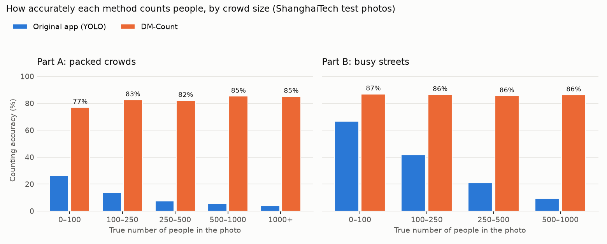
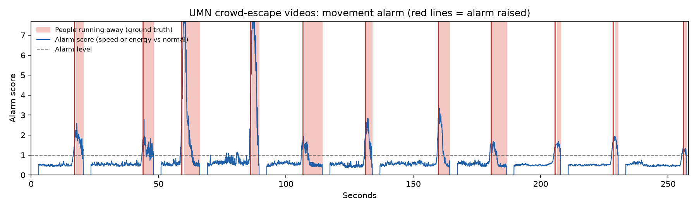

# Crowd Shield

Crowd Shield helps the people running an event or a station see crowd danger
**before** it turns into a crush. It counts people in photos and video, turns
the count into **people per square metre** for each zone, measures how the
crowd is moving, and warns when a zone is heading towards a dangerous density
or when a crowd suddenly panics.

India has lost too many people this way: at the Hathras satsang in 2024, at
the New Delhi railway station in 2025, and at religious gatherings, stadium
gates and festival crowds before them. In most of these crushes the warning
signs were there minutes before: too many people per square metre, and a
crowd starting to push. Crowd Shield is an attempt to measure those signs
with ordinary cameras.

## What it does

| | |
|---|---|
| **Count people** | A density-map model (DM-Count) estimates how many people are in each part of the image, so it keeps working when people overlap. YOLO draws boxes for display. |
| **People per m²** | Mark a rectangle of known size on the floor once (a few tiles, a doorway, parking lines). A homography maps every pixel to real ground area, so counts become densities. |
| **Danger levels** | From crowd-safety research: about 2.2 people/m² is where normal walking breaks down (Fruin), above 5 is a serious risk (Still), and around 7 a crowd moves "almost as a fluid mass" (Fruin, quoted by Helbing et al.). |
| **Crowd pressure** | Density × local velocity variance (Helbing, Johansson and Al-Abideen, 2007). In the 2006 Hajj disaster video, turbulent pushing began above 0.02 /s², and the crush came at its peak. |
| **Early warning** | "At the current trend, Zone B reaches 5 people per m² in about 4 minutes", from a robust (Theil-Sen) trend that one bad count can't swing. |
| **Panic alarm** | Optical flow spots a crowd suddenly moving much faster than its own normal pace, or much more of the view starting to move. |
| **Zone plans and alerts** | For photos: risk per zone, a plan for moving people from crowded zones into neighbouring ones with room, and email alerts to each zone's staff. |

The **Video** page puts this together: upload a clip from a fixed camera, mark
the floor rectangle and the zones, and get per-zone density, speed, pressure,
warnings and a CSV of every reading.

## How well it works

Every number below comes from data the method never saw while it was being
built or tuned.

### Counting people

Tested on the 498 test photos of ShanghaiTech, where every head is marked by
hand. Part A is packed crowds (433 people per photo on average), Part B is busy
streets (124 on average).



| | Packed crowds (A) | Busy streets (B) |
|---|---|---|
| Original app: YOLO boxes, faces add-on | **7%** accurate, off by 403 people per photo | **42%**, off by 72 |
| DM-Count trained for this project | **84%**, off by 70 | **86%**, off by 17 |

*Accuracy = 1 − total counting error ÷ total true count.* Full table, per-photo
results and the code that made them: [results/shanghaitech](results/shanghaitech),
[eval/evaluate_counting.py](eval/evaluate_counting.py),
[eval/compare_counting.py](eval/compare_counting.py).

What we learned along the way:

- **The original detector ignored crowds.** The standard YOLOv8 model counted
  13–21 people in most photos whether the photo held 9 people or 539. It was
  trained on COCO, where a tightly packed group is labelled as one "crowd" region
  and left out of YOLO's training labels, so it learned to treat crowds as background.
- **A suspected bug mattered less than expected.** Ultralytics keeps at most
  300 boxes per image by default. Raising that limit changed only 1 of 498 photos,
  because the detectors almost never found 300 people to begin with.
- **The faces add-on wasn't worth it.** It added about 5 people per photo and
  made counting 2–6× slower, so it's off by default (OpenCV 5 also dropped it).
- **Honest model selection.** DM-Count's own scripts pick the best training
  round by looking at the test photos. Here 10% of the *training* photos were
  held back to pick it, so the test photos stayed unseen. That partly explains
  why our numbers sit below the paper's (59.7 and 7.4 people per photo).

The model was trained on a free Kaggle GPU: 870 rounds, best at round 130.
The weights are published as a [release](https://github.com/khushi-git-7/Crowd_shield/releases/tag/dmcount-shab-v1)
and download automatically, with a checksum check, the first time the app counts.

### Spotting panic

Tested on the University of Minnesota crowd-escape videos: 11 clips in 3
scenes, each ending with everyone suddenly running away.



- **11 of 11 escapes caught, no false alarms**, a median 0.7 s before the
  dataset's own "abnormal" label appears. Looking at the frames, the label runs
  about a second late, so alarms up to 2 s before it count as catches.
- Speed alone missed three escapes in the indoor hall, where the camera is far
  away and running people only look 1.4–2× faster. A second signal, how much
  of the view is moving, catches them.
- To check that its level (8× normal) wasn't simply tuned to these clips, each
  scene was held out in turn: the level was chosen on the other two scenes and
  tested on the held-out one. It chose 8× every time and caught every held-out
  escape with no false alarms.
- Caveat: 11 clips from 3 scenes is a small test, and in one indoor clip the
  score briefly touches the alarm line while people are still walking. It
  doesn't fire, because the alarm needs half a second above the line, but the
  margin there is small.

Details: [results/umn](results/umn), [eval/evaluate_motion.py](eval/evaluate_motion.py).

## Run it

```bash
pip install -r requirements.txt
streamlit run main.py
```

Python 3.10+. Counting with the density model needs PyTorch, which Ultralytics
installs. Without it the app falls back to YOLO. Email alerts need
`GMAIL_USER` and `GMAIL_APP_PASSWORD` environment variables; see the
Settings page.

Tests: `pytest`. GitHub Actions also runs the real detector and density model
and renders every page.

## How it's built

```
crowdshield/          the core, with no UI code
  detection.py        YOLO boxes; the app's count (density model first, YOLO as fallback)
  density.py          DM-Count network, weight download and checks
  geometry.py         camera calibration: homography, pixel areas, ground speed
  safety.py           people per m², danger levels, crowd pressure
  motion.py           optical flow statistics and the panic alarm
  monitor.py          the video monitor: per-zone readings every second
  forecast.py         time until a zone reaches 5 people per m²
  risk.py             zone risk levels and relocation plans
eval/                 the accuracy tests behind every number above
pages/                the Streamlit app: Agents, Upload, Analysis, Video, Settings
results/              test results, per photo and per clip
```

## Limits

- ShanghaiTech is Chinese street and crowd photography. How well the counter
  does on Indian crowds (railway platforms, melas, temple queues) still needs
  its own test set; that is the next step.
- Density needs a calibrated, fixed camera. A moving phone video gives counts
  and speeds in pixels only.
- The early warning extends the recent trend in a straight line. It is a
  prompt for a human to look, not a prediction of the future.

## Team and credits

Crowd Shield began as a group project by **Khushi Jain** ([@khushi-git-7](https://github.com/khushi-git-7))
and [@SasmitaRK](https://github.com/SasmitaRK). Khushi researched, tested and
picked the VisDrone-trained YOLO model and built the first prototype; Sasmita
built the app's interface. Version 2 (counting accuracy, real units, crowd
pressure, video and the evaluations) is Khushi's work on this fork.

Built on: [DM-Count](https://github.com/cvlab-stonybrook/DM-Count) (Wang et al.,
NeurIPS 2020, MIT licence), [Ultralytics YOLO](https://github.com/ultralytics/ultralytics),
[ShanghaiTech](https://github.com/desenzhou/ShanghaiTechDataset) (Zhang et al.,
CVPR 2016), the [UMN unusual crowd activity](http://mha.cs.umn.edu/) videos,
and the crowd-safety research of J. J. Fruin, G. K. Still, and D. Helbing,
A. Johansson and H. Z. Al-Abideen (Phys. Rev. E 75, 046109, 2007).
