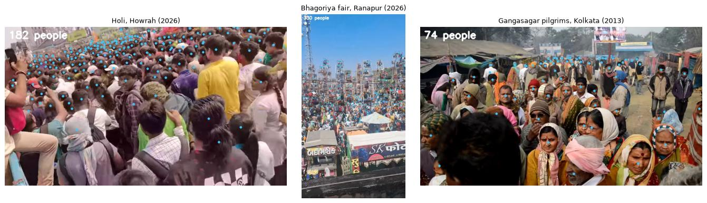

# Crowd Shield: measuring crowd danger with ordinary cameras, tested on Indian crowds

**Khushi** · Technical report, October 2026 · Code, data and models:
github.com/khushi-git-7/Crowd_shield · huggingface.co/Khushi-7/crowd-shield-counting ·
live demo: crowd-shield-india.streamlit.app

## Abstract

Crowd crushes happen when too many people stand in too little space and the crowd starts to
push. In most recent Indian disasters, at the Hathras satsang (2024), New Delhi railway
station (2025) and the Maha Kumbh (2025), those warning signs were visible minutes earlier. Crowd Shield is
an open-source tool that measures them from ordinary photos and video:

- people per square metre in each zone
- how fast and how chaotically the crowd moves
- how long a zone has until it becomes dangerous
- where to move people so that no zone is overfilled

Counting uses a point model (PET) fine-tuned with a strictly held-out protocol. On the
ShanghaiTech test sets it reaches **86.1%** accuracy on packed crowds and **92.1%** on street
scenes, against **7%** and **42%** for the detector the project started with. A movement alarm
catches **11 of 11** escape events in the UMN videos with no false alarms. On a new test set of
freely licensed Indian crowd photos, the first counter scored **66.7%** on 10 hand-checked photos
because it read railway ballast seen from above as heads. A second version, also trained on the
dense UCF-QNRF photos and on empty Indian tracks but never on an Indian crowd, scores **91.1%**
there, and is level with the first on ShanghaiTech within statistical noise. A field test on handheld Indian
festival video showed that motion readings need a fixed camera, which led to an automatic
moving-camera check. This report gives every number with the data and code behind it.

## 1. Why measure density

Crowd-safety research gives physical thresholds:

| Density | What happens |
|---|---|
| About 2.2 people/m² | Normal walking breaks down (Fruin) |
| Above 5 people/m² | A serious risk (Still) |
| Around 7 people/m² | The crowd moves "almost as a fluid mass" |

Helbing, Johansson and Al-Abideen (2007) showed in video of the 2006 Hajj disaster that
*crowd pressure* (density × the local variance of velocity) rose above about 0.02 per s² before
turbulent pushing began, and the crush came at its peak. A headcount alone is therefore not
enough: the quantities that matter are people per square metre and how the crowd moves.

## 2. System

Crowd Shield is a Python package (`crowdshield/`) and a Streamlit app. The package has no UI
code and is covered by tests.

1. **Count.** A point model puts one point on each head (§3). A density-map model and YOLO
   are fallbacks.
2. **Ground area.** For a fixed camera, four clicks on a floor rectangle of known size give a
   homography (direct linear transform with Hartley normalisation). The local area of each pixel
   is |det H| / w³, so counts become people/m². On the site map, each zone is a polygon on
   satellite imagery, and its area comes from the spherical-excess formula (Chamberlain &
   Duquette, 2007), the same formula Leaflet and Turf use.
3. **Movement.** Dense optical flow (Farnebäck) gives speed, the moving share of the view and
   turbulence. Crowd pressure uses the variance of velocity within 1 m cells.
4. **Early warning.** A Theil-Sen trend over the last minute of density estimates when a zone
   reaches 5 people/m². Theil-Sen is used because one bad count cannot swing it.
5. **Response.** Zones that touch (or lie within a set distance) form a walking graph. Each High
   Risk or Critical zone is paired with the nearest reachable Safe zone that has room, counting
   people already sent there so no zone is overfilled. The route is drawn on the map, and each
   zone's contact gets an email.

## 3. Counting people

**Data.** ShanghaiTech Part A has 482 photos of packed crowds and Part B has 716 street photos,
with every head marked by hand. The test sets (182 photos averaging 433 people, and 316 photos
averaging 124) were used once, at the end.

**Protocol.**

- 10% of the *training* photos (70) were held out. They pick the best training round and fit
  the count correction.
- The published DM-Count and PET training scripts pick the best round by looking at the test
  set; we did not.

**Models.**

- **DM-Count** was trained from scratch on A+B, with the best round (130) picked on the held-out
  photos.
- **PET** (Liu et al., ICCV 2023) started from its authors' JHU-Crowd++ model and was fine-tuned
  for 9.5 h on a free Kaggle T4, with the best round (240) picked on the held-out photos.
- **One count correction,** true ≈ 1.375 × raw^0.942, was fitted on the same 70 photos. It trims
  PET's overcounting in packed crowds and its undercounting on streets.
- **PET, second version** (section 4) was fine-tuned from the first on ShanghaiTech, UCF-QNRF and
  23 empty railway photos, with its own correction, true ≈ 1.340 × raw^0.947.

**Results** (accuracy = 1 − Σ|error| ÷ Σ true count):

| Counter | A: accuracy | A: off by per photo | B: accuracy | B: off by per photo |
|---|---|---|---|---|
| Original app (YOLO + Haar faces) | 7% | 403 | 42% | 72 |
| DM-Count (this project) | 84% | 70.1 | 86% | 16.9 |
| PET + correction (first version) | 86.5% | 58.5 | 92.7% | 9.0 |
| **PET, second version (the app's counter)** | **86.1%** | **60.4** | **92.1%** | **9.8** |

On Part A, PET's error is a little lower than the DM-Count paper's (59.7) and higher than PET's
own paper (49.1), which selected its model on the test set and trained one model per part. On
the very largest crowds (1,000+ people), DM-Count is slightly more accurate (85% against 83%).

**Why the original detector failed.** YOLOv8 trained on COCO counted 13–21 people in most photos,
whether a photo held 9 people or 539. COCO marks a tight group as a single "crowd" region, which
is left out of YOLO's training labels, so the detector learns to treat crowds as background. A
suspected bug, the 300-box cap, changed only 1 of 498 test photos.

## 4. Indian crowds

**Test set.** 105 freely licensed Wikimedia Commons photos:

- melas and pilgrimages (Kumbh, Gangasagar)
- festivals (Ganesh, Durga Puja, Chhath, Holi, Onam, Attukal Pongala, Bonalu, Madurai's
  Chithirai festival)
- temples and processions, stations, markets, stadiums and ghats

Each photo is credited and tagged with a scene. They are used only for testing.

**Labelling protocol.** The model's points are loaded as suggestions into a browser tool. A
person adds every missed head, removes wrong points, marks covered heads (sarees, dupattas,
turbans) and draws *ignore zones* over people too small or blurry to mark. Both truth and model
are counted outside the ignore zones. A second reviewer audits each photo with zoomed crops. So
far, 10 photos (3,507 heads) are complete.

**Pilot results, first version.**

- The counter scored between 81 and 100% on 9 of the 10 photos: 94, 89, 96, 81, 100, 90, 84, 92 and 93%.
- Overall accuracy is 66.7% (mean error 116.9), because of one systematic failure. On a top-down
  Mumbai railway photo it counted 1,267 heads against 415: the gravel between the tracks looks
  like a dense crowd.

**A negative result.** We tried to fix the railway failure by fine-tuning PET on ShanghaiTech,
the labelled Indian photos (oversampled) and 23 photos of empty Indian tracks with a true count
of zero.

- **Protocol:** 5-fold cross-validation over the Indian photos, so every photo was scored by a
  model that never saw it, with a fixed number of training rounds and no checkpoint picking.
- **The railway photo was fixed:** 379 against 415, and overall India accuracy rose from 66.7% to
  87.3%.
- **The other 9 photos got worse:** 89.5% → 86.8%. The model became cautious and undercounted
  small crowds; one photo fell from 90% to 68%.
- **ShanghaiTech also slipped slightly:** A 86.6% → 86.3%, B 92.6% → 92.6%.

Under the project's rule (ship a new model only if it is at least as good on ShanghaiTech and
better on held-out Indian photos), the fine-tuned model was not shipped.

**The second version.** Instead of training on the Indian test photos, PET was fine-tuned on more
kinds of crowds: ShanghaiTech (Part A twice over, so packed crowds would not be forgotten), the
1,201 dense UCF-QNRF training photos, which it had never seen, and the 23 empty-track photos as
about 1% of the set. No Indian crowd photo was trained on, so all 10 stay a clean test. Both models
were then run through the app's own counting code, with corrections refitted on held-out
ShanghaiTech training photos, and compared photo by photo with a paired bootstrap (10,000
resamples):

| Test | First version | Second version | Difference (95% interval) |
|---|---|---|---|
| Indian photos (10), full detail | 66.6% | 91.6% | +24.9 (−3.6 to +84.9) |
| Indian photos (10), hosted app | 67.9% | 86.1% | +18.2 (−1.4 to +61.9) |
| UCF-QNRF test (334) | 82.8% | 85.5% | +2.7 (+1.1 to +4.4) |
| ShanghaiTech A (182) | 86.4% | 86.1% | −0.4 (−2.2 to +1.3) |
| ShanghaiTech B (316) | 93.3% | 92.8% | −0.4 (−1.1 to +0.3) |

The decision rule was fixed before the bootstrap: switch if the ShanghaiTech intervals include
zero. They do, so the small drop there is within noise; the UCF-QNRF gain is real. The railway
photo is now counted as 455 (full detail) against 415, and the app ships the second version. On
the 10 Indian photos it is 91.1% accurate with the shipped correction (per photo: 95, 98, 95, 73,
90, 96, 79, 69, 92 and 97%). The Indian gain is large but not yet statistically proven on 10
photos; the hardest photo is now a Thane station scene, counted too low (311 against 425).

## 5. Movement

**Panic alarm.**

- **Test data:** the UMN crowd-escape videos, 11 clips in 3 scenes, each ending with everyone
  running away.
- **The alarm:** it fires when the crowd moves at least 2× its own normal speed, or when movement
  energy (speed × moving share) reaches 8× normal, for half a second.
- **Result:** it caught all 11 escapes with no false alarms, a median 0.7 s before the dataset's
  "abnormal" label, which runs about a second late by inspection.
- **Speed alone missed three indoor escapes,** where running people look only 1.4–2× faster from
  a distant camera.
- **The 8× level wasn't just tuned to these clips:** with each scene held out in turn, the other
  two scenes chose the same 8× level every time, and every held-out escape was caught with no
  false alarm.
- **Caveat:** 3 scenes is a small test, and in one clip the score briefly touches the line.

**Indian field test.** The video monitor ran on 15 Commons clips of Indian crowds: Holi in Howrah
(2026), the Bhagoriya fair, Gangasagar pilgrims, an eclipse crowd and a railway platform.

- There are no hand counts, so this checks behaviour, not accuracy.
- Head points held up in packed, partly covered crowds, from 10 to 330 people per frame.
- Analysis took about 1.4 s of T4 time per second of video.
- Every clip was handheld. That makes speed, pressure and the alarm measure the camera, not the
  crowd.

We added a camera-motion check: phase correlation between frames gives how far the whole picture
shifts.

- The fixed UMN camera stays at or under 1.4% of the frame width per second, even while people
  run.
- The handheld clips score 8–36%.
- Above 5%, the app warns and switches motion readings off, while still counting people.

**Speed.** On a plain 4-core cloud CPU with no GPU, PET takes a median 16 s per photo at 1280 px
(4.3 GB memory with both models loaded), and DM-Count 8 s. At 2048 px, PET takes 38 s. Photos are
practical on an 8 GB laptop; live video needs a GPU.

## 6. Privacy and ethics

- **No identity.** The counter outputs anonymous head points. There is no face recognition and
  no tracking of individuals; video measures movement per zone.
- **No storage.** Photos stay in the browser session, and video is written to a temporary file
  only while it's decoded.
- **What leaves the app.** Only optional email alerts, which include the busiest photo.
- **GDPR.** Keeping only aggregate counts follows data minimisation (GDPR Art. 5(1)(c)). A real
  deployment would still need a data protection impact assessment (Art. 35), signage, retention
  rules and a trained operator.
- **A prompt, not a decision.** Counts can be wrong, as §4 shows, so an alert is a prompt for a
  person to look, not an automatic decision.

## 7. Limitations

- The India test is a pilot: 10 of 105 photos are labelled.
- Density and pressure need a calibrated, fixed camera, and live video needs a GPU.
- The early warning extends a straight-line trend.
- The movement alarm was validated on 3 scenes.
- Map zones in the demos are illustrative, not official plans.
- The counter still undercounts some station scenes (a Thane photo by 27%).

## 8. Reproducibility

- Every number above comes from scripts in `eval/` and per-photo or per-clip results in
  `results/`.
- Trained weights are GitHub releases (`pet-qnrf-v1`, `pet-shab-v1`, `dmcount-shab-v1`), checked by
  SHA-256 when downloaded; the first two models are also mirrored on Hugging Face.
- Heavy runs used free Kaggle GPUs. Their scripts are in the repository.
- Tests run in GitHub Actions on every change.

## Credits

Crowd Shield began as a two-person final-year project by Khushi and Sasmita (@SasmitaRK), who
built the original Streamlit app. This report covers the v2 rebuild.

## References

- Chamberlain, R. G., & Duquette, W. H. (2007). *Some algorithms for polygons on a sphere.* JPL Publication 07-03.
- Fruin, J. J. (1971). *Pedestrian Planning and Design.*
- Helbing, D., Johansson, A., & Al-Abideen, H. Z. (2007). Dynamics of crowd disasters: An empirical study. *Physical Review E*, 75, 046109.
- Liu, C., Lu, H., Cao, Z., & Liu, T. (2023). Point-Query Quadtree for Crowd Counting, Localization, and More (PET). *ICCV*.
- Mehran, R., Oyama, A., & Shah, M. (2009). Abnormal crowd behavior detection using social force model (UMN dataset). *CVPR*.
- Still, G. K. (2014). *Introduction to Crowd Science.* CRC Press.
- Wang, B., Liu, H., Samaras, D., & Hoai, M. (2020). Distribution Matching for Crowd Counting (DM-Count). *NeurIPS*.
- Zhang, Y., Zhou, D., Chen, S., Gao, S., & Ma, Y. (2016). Single-image crowd counting via multi-column CNN (ShanghaiTech). *CVPR*.
